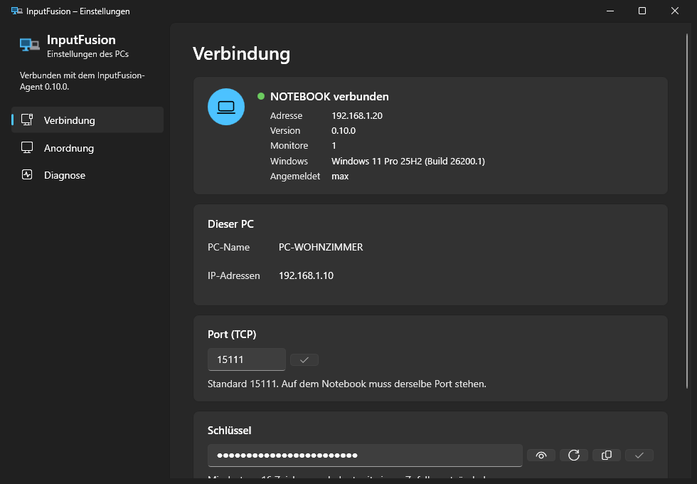
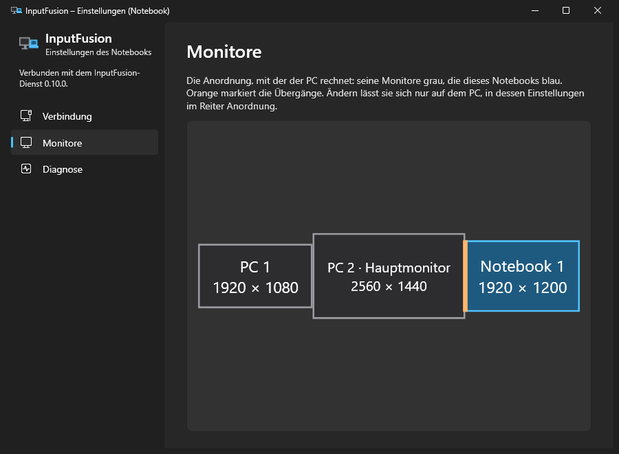

# InputFusion

**Eine Maus, eine Tastatur, zwei Rechner.** InputFusion steuert mit Maus und Tastatur des PCs zusätzlich ein Notebook: Die Maus wandert einfach über den Bildschirmrand hinüber, und alles, was danach getippt und geklickt wird, landet auf dem Notebook. Kein Umstecken, kein KVM-Switch, keine zweite Tastatur auf dem Schreibtisch.

InputFusion ist auf einen PC und ein Notebook zugeschnitten und richtet die Übergänge an einzelnen Monitoren aus statt an ganzen Rechnern. Wechselt das Notebook zwischen zwei Schreibtischen, etwa zu Hause und im Büro, kennt es beide PCs und verbindet sich mit dem, der gerade erreichbar ist.

## Funktionen

- **Nahtloser Wechsel über die Bildschirmkante.** Wo das Notebook neben den Monitoren des PCs liegt, legst du per Ziehen fest. An den anliegenden Kanten wechselt die Maus hin und zurück; jede Kombination aus Monitoren, etwa angedockt oder unterwegs, merkt sich ihre eigene Anordnung.
- **Tastatur samt Tastenkürzeln.** Gehaltene Umschalt-, Strg-, Alt- und Windows-Tasten gehen beim Wechsel mit und hängen danach nicht fest. `Strg+Alt+F12` holt die Maus jederzeit zurück auf den PC.
- **Auch Sperrbildschirm, Anmeldung und UAC-Abfrage.** Auf dem Notebook spielt ein Windows-Dienst die Eingaben ab, so lassen sich auch der Anmeldebildschirm und erhöhte Fenster wie der Task-Manager bedienen.
- **Gemeinsame Zwischenablage.** Text, der auf dem einen Rechner kopiert wird, lässt sich auf dem anderen einfügen.
- **Win+L sperrt beide Rechner.**
- **Verschlüsselt und gegenseitig angemeldet.** Beide Seiten weisen sich mit einem gemeinsamen Schlüssel aus, der selbst nie über das Netz geht. Jede Verbindung wird per ECDH mit eigenem Schlüssel ausgehandelt und mit AES-GCM verschlüsselt; mitgeschnittener Verkehr bleibt auch dann unlesbar, wenn der Schlüssel später bekannt wird. Einen neuen Schlüssel übernimmt ein verbundenes Notebook von selbst.
- **Findet den PC über seinen Namen.** Das Notebook verbindet sich über den Rechnernamen, per IPv4 oder IPv6, und nach Standby oder Netzwechsel von selbst neu. Mehrere PCs lassen sich eintragen; das Notebook versucht alle zugleich und nimmt den, der antwortet.
- **Hält sich selbst aktuell.** PC und Notebook laden neue Versionen aus den GitHub-Releases und spielen sie ein, ohne die Arbeit zu unterbrechen.
- **Sagt, was los ist.** Bricht die Verbindung ab, meldet das Tray-Symbol den Grund. Der Bereich Diagnose zeigt Laufzeit, Nachrichten pro Sekunde, die letzte Störung und die jüngsten Meldungen.
- **Modernes Windows-11-Design**, hell oder dunkel nach der Windows-Einstellung.

## So funktioniert es

Auf dem PC läuft InputFusion als Symbol im Infobereich der Taskleiste. Er fängt Maus und Tastatur ab, sobald die Maus über eine Übergangskante auf das Notebook wechselt, und schickt die Eingaben dorthin. Auf dem Notebook nimmt ein Windows-Dienst sie entgegen und spielt sie ab. Die Einstellungen öffnen sich auf beiden Seiten per Doppelklick auf das Tray-Symbol: Auf dem PC wird die Anordnung festgelegt, auf dem Notebook ist sie zur Kontrolle zu sehen.

## Voraussetzungen

- Windows, 64 Bit (x64), auf PC und Notebook, im Einsatz unter Windows 11
- Beide Rechner im selben Netzwerk; auf dem PC ist ein Port für eingehende Verbindungen offen (Standard TCP 15111, die Firewall-Regel legt InputFusion selbst an)
- .NET 10 Desktop Runtime; das Setup des PCs bringt sie bei Bedarf mit

## Installieren

Beide Dateien gibt es im [neuesten Release](https://github.com/NicoMertens/input-fusion/releases/latest).

1. **PC:** `InputFusion.Host-win-Setup.exe` ausführen. Beim ersten Start fragt InputFusion einmal nach Adminrechten, um künftig mit der Anmeldung zu starten und die Firewall zu öffnen. In den Einstellungen stehen danach PC-Name und Schlüssel.
2. **Notebook:** `InputFusion.Client-Setup.exe` per Doppelklick starten, PC-Name und Schlüssel eingeben, bei Bedarf auch für einen zweiten PC. Das Setup richtet den Dienst ein, die Verbindung steht sofort. Weitere PCs lassen sich später in den Einstellungen des Notebooks eintragen.
3. Auf dem PC in den Einstellungen unter **Anordnung** das Notebook an die Kante ziehen, an der es auf dem Schreibtisch steht.

Einzelheiten, auch zur Installation per Skript, unter [`docs/installation.md`](docs/installation.md).
